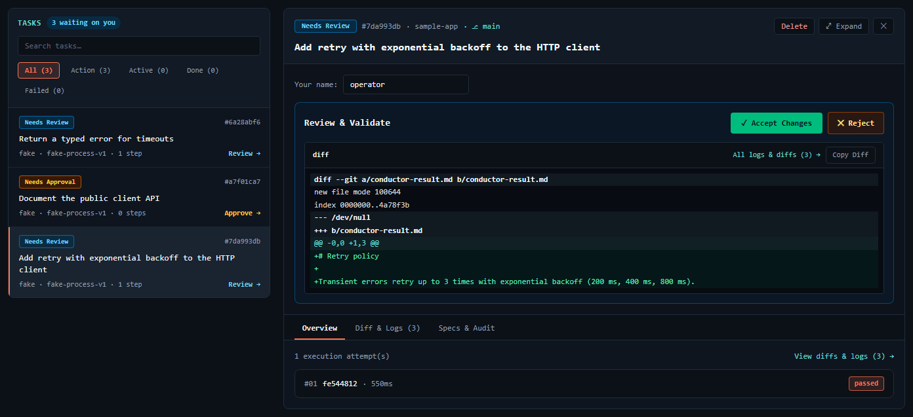

# Clatterforge

**Coding agents, on a short and well-documented leash.**

Clatterforge is a local-first forge for coding agents. You approve the scope. Local workers (the Cursor and Codex CLIs you already use, routed by a local model) write the change in their own Git worktree, not your checkout. You review the diff and an independent verifier's evidence, and the forge applies nothing to your checkout until you accept it.



<sub>A real screenshot of v0.1.0 reviewing a demo repository, with the built-in test worker.</sub>

[**Download v0.1.0**](../../releases/latest) · Windows · macOS · Linux · Apache-2.0 · alpha

## Why

Coding agents are fast and confidently wrong often enough that you want a record of what they did, under what instructions, and whether anything independent checked it. Clatterforge doesn't try to make agents smarter. It makes their work accountable:

- **Approval binds to an exact assignment.** Scope, worker, verifier and limits are approved together, and the approval is tied to that revision. Change anything and it needs a new one.
- **Runs are supervised.** Workers run as owned process trees with timeouts, cancellation and a global stop. A crash leaves the task marked unknown with its evidence; it is never silently rerun.
- **Verification is independent.** A separate verifier decides pass or fail. What the agent claims about its own work is recorded, never trusted as proof.
- **Integration is a separate step.** You apply an accepted change as unstaged edits (from the desktop, API or CLI), or deliver it as a commit on a new branch, optionally pushed as a pull request (CLI). Neither happens automatically.

What it does **not** do matters as much: a worktree isolates Git changes, not processes, and the coding CLIs still run with your account, profile and network. The [security boundaries](SECURITY.md) spell out exactly what is and isn't enforced.

## How it works

1. **Objective.** Describe the change. The forge records repository context and the exact base commit.
2. **Approval.** You approve one assignment. In a multi-step workflow, a local model (for example Gemma via Ollama) picks which approved worker runs next; it can only choose from what you approved.
3. **Supervised run.** Cursor or Codex works in an isolated worktree under the forge's process supervision.
4. **Review.** You get the candidate diff, logs and the verifier's result. Review comments feed the next repair round.
5. **Integration.** Apply the accepted candidate as unstaged changes, or deliver it as a branch and pull request; see [integration](docs/runbook/integration.md).

The desktop app, an authenticated HTTP API and an MCP server all drive the same task lifecycle. Edge clients ("Sparks") on other machines connect to one main forge, which alone holds state and policy.

## Install

Download the installer for your platform from the [latest release](../../releases/latest):

| Platform | File | Notes |
|---|---|---|
| Windows x64 | `Clatterforge_<version>_x64-setup.exe` | Per-user install. Not yet code-signed, so SmartScreen warns on first run. |
| macOS, Apple silicon | `Clatterforge_<version>_aarch64.dmg` | Signed and notarized. |
| macOS, Intel | `Clatterforge_<version>_x64.dmg` | Signed and notarized. |
| Linux x86_64 | `Clatterforge_<version>_amd64.AppImage` | Single file, updates itself. |
| Debian / Ubuntu | `Clatterforge_<version>_amd64.deb` | No update channel yet (no apt repository): install each new release yourself. |

The Windows, macOS and AppImage builds update themselves; every update is signed and verified before it installs. Only the macOS builds are code-signed. Your state lives outside the install folder, so updates and uninstalls leave it alone.

**To run real work you also need:**

- **Git**, and a repository you are willing to point agents at.
- **The Codex CLI and/or the Cursor CLI**, installed and signed in with their own instructions. Clatterforge does not bundle accounts or install provider tools.
- **For multi-step workflows, a local model** to route between workers, served by [Ollama](https://ollama.com). The [example configuration](examples/orchestration-gemma26b-config.json) uses Gemma; the [inference guide](docs/INFERENCE.md) covers limits. A single-worker task needs no model.
- **Optional: Docker**, to run verifiers in a pinned sandbox image.

Then set up a worker preset and your first workflow with the [workflows runbook](docs/runbook/workflows.md), using a throwaway repository first.

## Build from source

You need Git, Rust 1.90.0 (on Windows, native with the Visual Studio C++ build tools) and Python 3.11 or later. SQLite is bundled. The test suite needs no model, provider account or network service.

```sh
cargo +1.90.0 fetch --locked
cargo +1.90.0 test --workspace --locked -- --test-threads=4
```

On Windows, `scripts/demo.ps1` creates a throwaway repository, runs one task with simulated approval and leaves a patch awaiting review. Installer builds are described in the [packaging runbook](docs/runbook/packaging.md).

## Status

This is an **alpha**. Working today: the main forge on Windows, macOS and Linux, with installers whose updates are signed and verified (macOS builds are also code-signed and notarized); Linux edge clients; the web client; the HTTP and MCP interfaces; and an optional verifier sandbox (Docker, or a Windows AppContainer). Still in progress: Windows and Linux code signing, guided onboarding, and automatic recovery. The [release notes](docs/RELEASE.md) track the remaining gates.

**Known issue in v0.1.0:** on Windows the app's window does not load its interface (the backend runs, the window shows a file-not-found page). Linux and macOS are not affected by the same cause. See the [release blockers](docs/RELEASE.md#release-blockers).

## Documentation

- [Architecture](docs/ARCHITECTURE.md) and the [workflows runbook](docs/runbook/workflows.md)
- [First-agent guide](docs/FIRST_AGENT.md), for coding agents working on this repository
- [Runbook](docs/runbook/00_INDEX.md): workflows, review, integration and host operations
- [Remote access](docs/REMOTE_ACCESS.md) and [local inference](docs/INFERENCE.md)
- [Security boundaries](SECURITY.md), [contributing](CONTRIBUTING.md) and [release gates](docs/RELEASE.md)

The project website is linked in this repository's About section.

## License

Clatterforge is licensed under [Apache-2.0](LICENSE), with attribution in [NOTICE](NOTICE). Dependencies keep their own terms; [third-party notices](THIRD_PARTY_NOTICES.md) collect them. Model weights and external CLI tools are installed and licensed separately.

<sub>Formerly Dev Conductor. The binary is `clatterforge` (setup scripts also install `dev-conductor` as an alias), and an existing `.conductor` state directory keeps working.</sub>
